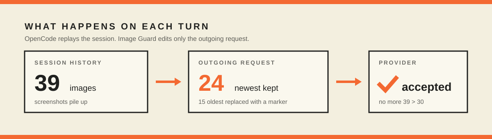

# Image Guard

**A session shouldn't die because a screenshot got old.**

OpenCode replays the conversation on every turn. Attach enough screenshots and the provider eventually refuses the whole request:

```text
Upstream request failed: [invalid_request_error]
Too many images in request: 39 > 30
```

There is no setting to raise that cap. Image Guard keeps the newest images and replaces the older ones in the outgoing request, so the session keeps moving.

[](https://github.com/HoboStank/opencode-image-guard/actions/workflows/test.yml)
[](LICENSE)
[](https://opencode.ai/v2/docs/)

[Install](#install) · [How it works](#how-it-works) · [Options](#options) · [Good to know](#good-to-know) · [Development](#development)

---

## Why this exists

Most providers cap how many images a single request can carry. OpenCode sends the whole session every time, so a long chat with screenshots slowly walks into that ceiling. Once it does, every new turn fails before the model even sees it.

Deleting screenshots by hand works until it doesn't. Starting over loses the thread. Image Guard is the small, boring fix: keep the newest images, drop the oldest ones from the request, and leave the session alone.



## How it works

1. OpenCode assembles the messages for a model request.
2. Image Guard counts image parts from newest to oldest.
3. The newest `maxImages` stay.
4. Older image parts become a short text marker:
   `[an older image was omitted from this request to stay within the model's image limit]`
5. The request goes out under the cap.

Only the outgoing request changes. The session still shows every original image, and nothing is deleted from disk.

## Install

Clone it into your OpenCode plugins directory:

```bash
git clone https://github.com/HoboStank/opencode-image-guard.git \
  ~/.config/opencode/plugins/image-guard
```

PowerShell:

```powershell
git clone https://github.com/HoboStank/opencode-image-guard.git `
  "$env:USERPROFILE\.config\opencode\plugins\image-guard"
```

Add it to `opencode.json` (or `opencode.jsonc`):

```jsonc
{
  "$schema": "https://opencode.ai/config.json",
  "plugins": [
    {
      "package": "C:\\Users\\you\\.config\\opencode\\plugins\\image-guard",
      "options": {
        "maxImages": 24
      }
    }
  ]
}
```

Restart OpenCode. The defaults are already useful; the object form is only needed when you want to tune it.

## Options

| Option | Default | What it does |
| --- | --- | --- |
| `maxImages` | `24` | Image parts kept per request. `0` disables the guard. |
| `providerID` | `"opencode-go"` | Only guard this provider. Set `false` for every provider. |
| `debug` | `false` | Log pruning decisions through `console.error`. |

The OpenCode Go cap is **30 images per request**, so `29` is the highest useful value. The default of `24` leaves headroom for provider-side counting differences.

## Good to know

- The newest images always survive. Older ones are replaced, never silently deleted from history.
- Images returned by tools count too.
- If one message carries more than `maxImages` images, that message's oldest images go first.
- A pruning failure is logged (with `debug`) and never blocks the request.
- The plugin is scoped to `opencode-go` by default. If your provider has a different limit, change `providerID` or set it to `false`.

## Development

Requires [Bun](https://bun.sh/). OpenCode loads the TypeScript directly; there is no build step.

```bash
bun test
```

The tests cover image detection, counting, pruning order, shape preservation, and option normalization.

## License

MIT. Not affiliated with OpenCode.

---

<p align="center">
  <sub>Built by <a href="https://www.madebyhobo.com">madebyhobo</a> · <a href="https://x.com/HoebenChris">@HoebenChris</a></sub>
</p>
